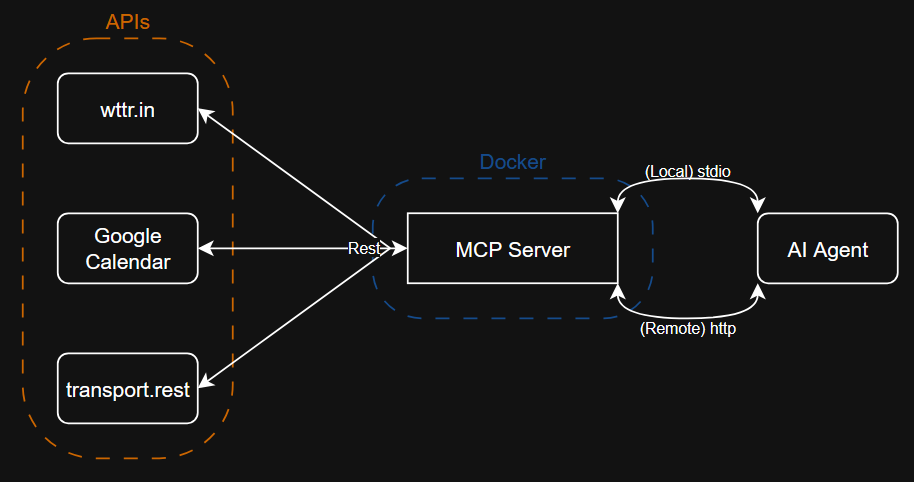

# MCP-Server - Personal Assistant Backend


## Contributors
- [**Aiham Zaria**](@staizari)
- [**Artur Castilho Lau**](@starcasti)
- [**Auriand Dester Ngouateu Kemma**](@staungoua)
- [**Mohamed Hamada**](@stmohamad)
- [**Omar Ibrahim Arfa**](@stomarfaa)
- [**Simon Pototzki**](@stsipotot)

---

## Project Idea & Objectives
The MCP Server (Model Context Protocol Server) forms the technical foundation for building a personal AI assistant.  
It enables standardized communication between AI systems and external applications through a unified protocol.

**Goal:**  
To develop a modular Python-based server that communicates with an AI agent (e.g., Claude or GPT-5) and aggregates information from multiple data sources.

### Key Features
- Weather Module → Forecasts (e.g., outfit recommendations)  
- Calendar Module → Daily overview & event management  
- Unified access layer for external APIs (e.g., Open-Meteo, Google Calendar)  
- Extensible design for new modules and data sources 

---
## Tech Stack
- **Language:** Python 3.14+
- **Libraries & Frameworks:**
  - Fast MCP (Model Context Protocol implementation)
  - httpx / Requests (API communication)
  - dotenv (Environment variable management)
  - pytest (Testing framework)
- **Development Tools:**
  - uv (Package manager)
  - Ruff (Linter and formatter)
---
## Architecture Overview

---
# Getting Started
While this guide focuses specifically on integrating the server with Claude Desktop, the MCP server is not limited to Claude alone - you can also use it with other AI Agents such as Cline, Continue & Open Interpreter.

### Prerequisites
- Python 3.11 or higher installed
- The MCP Server script available locally
- [Claude Desktop](https://www.claude.com/download) installed (and also registered)

## Adding MCP Server to Claude
1. Open **Claude Desktop**.
2. Open the User Menu (buttom-left) and Navigatie to **Settings** $\rightarrow$ **Developer**
3. Click on **Edit Config** and the file explorer will open the certain directory.
4. Open the file **claude-desktop_config.json** and replace everything the following JSON:

```json
{
  "mcpServers": {
    "personal-assistant": {
      "command": "/path_to/python.exe",
      "args": [
        "-u",
        "/path_to/main.py"
      ]
    }
  }
}
```
You have to change the file paths of course.

Example paths for windows:<br>
`C:\\Users\\USER\\AppData\\Local\\Programs\\Python\\Python314\\python.exe`<br>
`C:\\Users\\USER\\PycharmProjects\\ws25_26_apip_do1_grp04\\main.py`


## Starting the Server
0. After adding the Server you have to **restart** Claude Desktop.
1. Open a new conversation.
2. Ask him something he can answer using the tools provided.
3. Have fun :^)

---

# Google Calendar MCP Functions

The MCP server exposes five primary tools for Google Calendar integration:

### 1. `list_calendar_events`
Description: Lists calendar events within a specified time window.

Parameters:
- `calendar_id` (str, optional): Calendar ID (default: `"primary"`).
- `time_min` (str, optional): Start time in RFC3339 (e.g., `"2025-11-17T09:00:00Z"`).
- `time_max` (str, optional): End time in RFC3339 (e.g., `"2025-11-17T17:00:00Z"`).
- `max_results` (int, optional): Maximum number of events to return.
- `q` (str, optional): Free-text search across title, description, location, participants, and more.
- `single_events` (bool, optional): If `true`, returns recurring events as single instances (default: `true`).
- `order_by` (str, optional): Sort field (`"startTime"` or `"updated"`, default: `"startTime"`).

Use cases: Daily/weekly overview, querying specific terms, or filtered views. See API docs: https://developers.google.com/calendar/api/v3/reference/events/list

### 2. `create_calendar_event`
Description: Creates a new Google Calendar event.

Required parameters:
- `calendar_id` (str): Target calendar ID.
- `start` (str): Start time (RFC3339) or `YYYY-MM-DD` for all-day events.
- `end` (str): End time (RFC3339) or `YYYY-MM-DD` for all-day events.

Optional parameters:
- `summary` (str): Event title (default: `"untitled event"`).
- `timezone` (str): IANA timezone (e.g., `"Europe/Berlin"`).
- `description` (str): Long description.
- `location` (str): Human-readable location.
- `attendees` (str): JSON string of attendee objects, e.g. `[{"email":"alice@example.com"}]`.
- `all_day` (bool): Set `true` for all-day events (default: `false`).
- `color_id` (str): Event color ID (1–11).
- `recurrence` (str): JSON string of recurrence rules (RRULE, RDATE, etc.).
- `reminders` (str): JSON string for reminders config.
- `transparency` (str): `"opaque"` or `"transparent"`.
- `visibility` (str): `"default"`, `"public"`, `"private"`, `"confidential"`.
- `guests_can_invite_others` (bool): Whether guests can invite others.
- `guests_can_modify` (bool): Whether guests can modify the event.
- `guests_can_see_other_guests` (bool): Whether guests can see other attendees.
- `send_updates` (str): Guest notification behavior (`"all"`, `"externalOnly"`, `"none"`).
- `max_attendees` (int): Maximum number of attendees.

Use cases: Create meetings, reminders, or all-day events. See API docs: https://developers.google.com/calendar/api/v3/reference/events/insert

### 3. `get_calendar_list`
Description: Returns the user’s available Google Calendars.

Parameters:
- `max_results` (int, optional): Maximum number of calendars to return.
- `min_access_role` (str, optional): Minimum access role (`"freeBusyReader"`, `"reader"`, `"writer"`, `"owner"`).
- `show_hidden` (bool, optional): Include hidden calendars if `true`.

Use cases: Discover calendar IDs for later operations. See API docs: https://developers.google.com/calendar/api/v3/reference/calendarList/list

### 4. `delete_calendar_event`
Description: Deletes an event from a specified calendar.

Parameters:
- `calendar_id` (str): ID of the calendar (e.g. `"primary"`).
- `event_id` (str): ID of the event to delete (from `list_calendar_events` results).
- `send_updates` (str, optional): Notification behavior for guests (`"all"`, `"externalOnly"`, `"none"`).

Use case: Remove canceled meetings. See API docs: https://developers.google.com/calendar/api/v3/reference/events/delete

### 5. `update_calendar_event`
Description: Updates an existing Google Calendar event with a full (PUT) update.

Parameters:
- `calendar_id` (str): ID of the calendar (e.g. "primary").
- `event_id` (str): ID of the event to update (from `list_calendar_events` results).
- `start` (str, optional): New start time (RFC3339 or YYYY-MM-DD for all-day).
- `end` (str, optional): New end time (RFC3339 or YYYY-MM-DD for all-day).
- `summary` (str, optional): New event title.
- `timezone` (str, optional): IANA timezone (e.g., "Europe/Berlin").
- `description` (str, optional): New long description.
- `location` (str, optional): New human-readable location.
- `attendees` (str, optional): JSON string of attendee objects, e.g. `[{"email":"alice@example.com"}]`.
- `all_day` (bool, optional): Set `true` for all-day event.
- `color_id` (str, optional): New event color ID (1–11).
- `recurrence` (str, optional): JSON string of recurrence rules.
- `reminders` (str, optional): JSON string for reminders config.
- `transparency` (str, optional): "opaque" or "transparent".
- `visibility` (str, optional): "default", "public", "private", "confidential".
- `guests_can_invite_others` (bool, optional): Whether guests can invite others.
- `guests_can_modify` (bool, optional): Whether guests can modify the event.
- `guests_can_see_other_guests` (bool, optional): Whether guests can see other attendees.
- `send_updates` (str, optional): Guest notification behavior ("all", "externalOnly", "none").
- `max_attendees` (int, optional): Maximum number of attendees.

Use case: Change time, title, description, participants, or other details of an existing event. See API docs: https://developers.google.com/calendar/api/v3/reference/events/update

**Important Note:**
> This tool performs a full update (PUT). Before updating, the event is loaded via GET to ensure all required fields are present. Only the fields you specify are changed; all others remain as in the original event. This prevents accidental data loss and ensures compatibility with the Google Calendar API.

---

## Detailed Preparation for Google Calendar Registration

To enable your Python application to work with Google Calendar, follow these steps:

### 1. Create a Google Cloud Project

- Go to the [Google Cloud Console](https://console.cloud.google.com/).
- Click on “Select Project” at the top, then “New Project.”
- Enter a project name and create the project.

### 2. Enable the Google Calendar API

- Select your project in the Cloud Console.
- Navigate to “APIs & Services” > “Library.”
- Search for “Google Calendar API” and click “Enable.”

### 3. Create OAuth 2.0 Credentials

- Go to “APIs & Services” > “Credentials.”
- Before you can create an OAuth client ID, you must configure your consent screen:
  1. Click the “Configure consent screen” button.
  2. You will be taken to the “Branding” section of the OAuth consent screen setup.
  3. Click the blue “Get started” button.
  4. Fill in the required information:
     - **App name:** Enter a name for your application.
     - **User support email:** Select or enter your email address.
  5. In the “Audience” section:
     - Select “External” if you want to use your app with any Google account, then click “Next” to continue.
  6. **Contact Information:** Enter a developer contact email.
  7. **Finish:** Review and save your consent screen configuration.
- You will be redirected to the OAuth Overview page.
- Click the “Create OAuth client” button.
- Choose “Desktop app” as the application type.
- Enter a name for your client and click “Create.”
- Download the `credentials.json` file.

### 4. Configure Your Application to Use Environment Variables

You must have the following pattern in your `claude_desktop_config.json` file (replace paths and names as needed for your project):

```json
{
  "mcpServers": {
    "YOUR_SERVER_NAME": {
      "command": "PATH_TO_PYTHON_EXECUTABLE",
      "args": [
        "PATH_TO_YOUR_MAIN_PY"
      ],
      "env": {
        "GOOGLE_CALENDAR_CREDENTIALS_FILE": "PATH_TO/credentials.json",
        "GOOGLE_CALENDAR_TOKEN_FILE": "PATH_TO/token.json"
      }
    }
  }
}
```
This structure ensures your application uses the correct environment variables for Google Calendar authentication.
