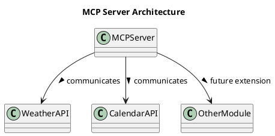

# MCP-Server - Personal Assistant Backend
**ws25_26_apip_do1_grp04**

## Contributors
- [**Aiham Zaria**](@staizari)
- [**Artur Castilho Lau**](@starcasti)
- [**Auriand Dester Ngouateu Kemma**](@staungoua)
- [**Mohamed Hamada**](@stmohamad)
- [**Omar Ibrahim Arfa**](@stomarfaa)
- [**Simon Pototzki**](@stsipotot)

---

## Project Idea & Objectives
The MCP Server (Model Context Protocol Server) forms the technical foundation for building a personal AI assistant.  
It enables standardized communication between AI systems and external applications through a unified protocol.

**Goal:**  
To develop a modular Python-based server that communicates with an AI agent (e.g., Claude or GPT-5) and aggregates information from multiple data sources.

### Key Features
- Weather Module → Forecasts (e.g., outfit recommendations)  
- Calendar Module → Daily overview & event management  
- Unified access layer for external APIs (e.g., Open-Meteo, Google Calendar)  
- Extensible design for new modules and data sources  

---
## Tech Stack
- **Language:** Python 3.14+
- **Libraries & Frameworks:**
  - Fast MCP (Model Context Protocol implementation)
  - httpx / Requests (API communication)
  - dotenv (Environment variable management)
  - pytest (Testing framework)
- **Development Tools:**
  - uv (Package manager)
  - Ruff (Linter and formatter)
---
## Architecture Overview
