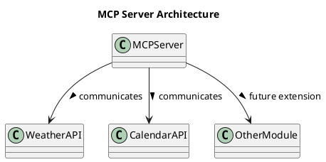

# MCP-Server - Personal Assistant Backend


## Contributors
- [**Aiham Zaria**](@staizari)
- [**Artur Castilho Lau**](@starcasti)
- [**Auriand Dester Ngouateu Kemma**](@staungoua)
- [**Mohamed Hamada**](@stmohamad)
- [**Omar Ibrahim Arfa**](@stomarfaa)
- [**Simon Pototzki**](@stsipotot)

---

## Project Idea & Objectives
The MCP Server (Model Context Protocol Server) forms the technical foundation for building a personal AI assistant.  
It enables standardized communication between AI systems and external applications through a unified protocol.

**Goal:**  
To develop a modular Python-based server that communicates with an AI agent (e.g., Claude or GPT-5) and aggregates information from multiple data sources.

### Key Features
- Weather Module → Forecasts (e.g., outfit recommendations)  
- Calendar Module → Daily overview & event management  
- Unified access layer for external APIs (e.g., Open-Meteo, Google Calendar)  
- Extensible design for new modules and data sources  

---
## Tech Stack
- **Language:** Python 3.14+
- **Libraries & Frameworks:**
  - Fast MCP (Model Context Protocol implementation)
  - httpx / Requests (API communication)
  - dotenv (Environment variable management)
  - pytest (Testing framework)
- **Development Tools:**
  - uv (Package manager)
  - Ruff (Linter and formatter)
---
## Architecture Overview

---

## Detailed Preparation for Google Calendar Registration

To enable your Python application to work with Google Calendar, follow these steps:

### 1. Create a Google Cloud Project

- Go to the [Google Cloud Console](https://console.cloud.google.com/).
- Click on “Select Project” at the top, then “New Project.”
- Enter a project name and create the project.

### 2. Enable the Google Calendar API

- Select your project in the Cloud Console.
- Navigate to “APIs & Services” > “Library.”
- Search for “Google Calendar API” and click “Enable.”

### 3. Create OAuth 2.0 Credentials

- Go to “APIs & Services” > “Credentials.”
- Before you can create an OAuth client ID, you must configure your consent screen:
  1. Click the “Configure consent screen” button.
  2. You will be taken to the “Branding” section of the OAuth consent screen setup.
  3. Click the blue “Get started” button.
  4. Fill in the required information:
     - **App name:** Enter a name for your application.
     - **User support email:** Select or enter your email address.
  5. In the “Audience” section:
     - Select “External” if you want to use your app with any Google account, then click “Next” to continue.
  6. **Contact Information:** Enter a developer contact email.
  7. **Finish:** Review and save your consent screen configuration.
- You will be redirected to the OAuth Overview page.
- Click the “Create OAuth client” button.
- Choose “Desktop app” as the application type.
- Enter a name for your client and click “Create.”
- Download the `credentials.json` file.

### 4. Configure Your Application to Use Environment Variables

You must have the following pattern in your `claude_desktop_config.json` file (replace paths and names as needed for your project):

```json
{
  "mcpServers": {
    "YOUR_SERVER_NAME": {
      "command": "PATH_TO_PYTHON_EXECUTABLE",
      "args": [
        "PATH_TO_YOUR_MAIN_PY"
      ],
      "env": {
        "GOOGLE_CALENDAR_CREDENTIALS_FILE": "PATH_TO/credentials.json",
        "GOOGLE_CALENDAR_TOKEN_FILE": "PATH_TO/token.json"
      }
    }
  }
}
```

This structure ensures your application uses the correct environment variables for Google Calendar authentication.